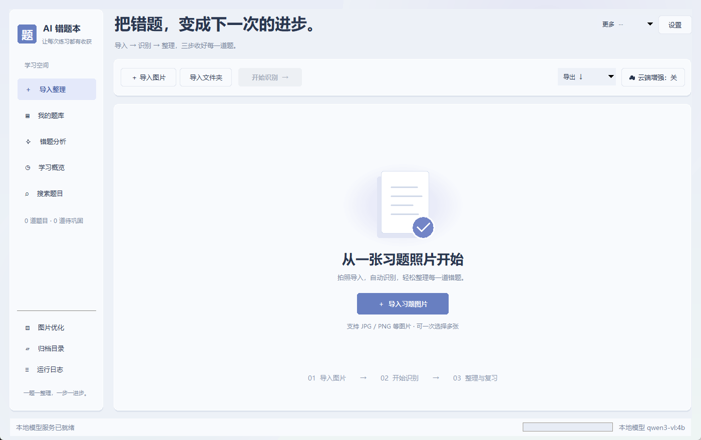
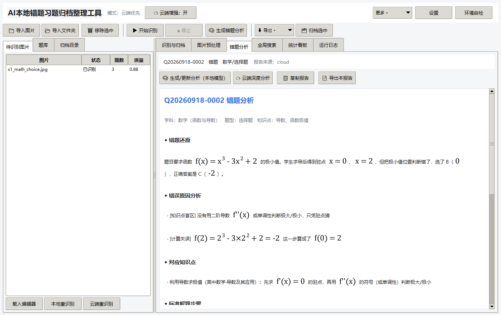
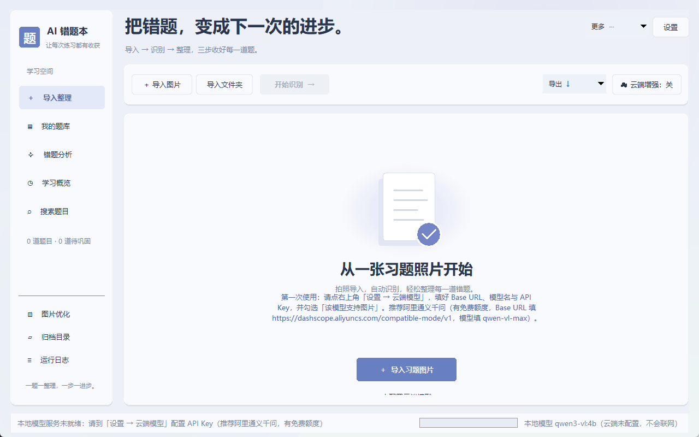

# AI 错题本 · 拍照即归档的错题整理工具

> **把手机拍的错题照片，自动变成可复习、可打印、能按知识点查找的错题本。**
> 识别题干与手写作答 → 判定对错 → 自动分类归档 → 逐题生成错题分析 → 一键导出 Word / PDF。
> 纯 Python 标准库实现，零第三方依赖；识别可以用云端模型，也可以完全离线跑在本机。

**🔗 [在线演示](https://1461164308-bot.github.io/exercise-archive/)** —— 不用下载，直接看界面与完整使用流程。




---

## ⚠️ 先看这一条：压缩包**自带 Python，但不含 AI 模型**

便携版（Releases 里的 `exercise-archive-portable-*.zip`）已经把 **Python 运行时**打进去了 ——
**目标电脑不需要装 Python、也不需要命令行**。但它**不包含任何 AI 模型**：模型动辄几 GB，
而且该用哪个取决于你的电脑和预算，所以必须由你选一条：

| 方案 | 要准备什么 | 适合谁 |
| --- | --- | --- |
| **① 云端模型（推荐，开箱 5 分钟）** | 一个 API Key（**阿里通义千问有免费额度**） | 大多数用户：没有独立显卡也能用 |
| ② 本地模型（完全离线） | 装 [Ollama](https://ollama.com) + `ollama pull qwen3-vl:4b`（约 3 GB，需 4~6 GB 显存） | 有显卡、在意隐私、想省 API 费用 |

**只做了第 1 步就去识别，会得到「0 道题」** —— 因为软件还不知道该把图片交给谁看。
没配好模型时，软件会在首页用一条醒目提示告诉你该去哪填（见下图）。



---

## 🚀 快速开始（四步）

1. **下载**：打开本仓库的 [**Releases**](../../releases) 页，下载 **`exercise-archive-portable-v1.2.0.zip`**（约 19 MB，带 `portable` 字样的那个）。
   （另一个 `exercise-archive-source-v1.2.0.zip` 是纯源码，需要目标电脑已装 Python。）
2. **解压**：解压到**不含中文和空格的路径**，例如 `D:\AI错题本`
   （不要放在 `C:\Program Files` 下——那里没有写权限，题库会存不下来）。
3. **启动**：双击解压出来的 **`启动.bat`**。窗口打开即成功，此时还识别不了，先做第 4 步。
4. **配好云端模型**：右上角 **「设置」→「云端模型」**，填 4 项后保存：

   | 字段 | 填什么（以阿里通义千问为例，有免费额度） |
   | --- | --- |
   | Base URL | `https://dashscope.aliyuncs.com/compatible-mode/v1` |
   | 模型名 | `qwen-vl-max`（或 `qwen-vl-plus`） |
   | API Key | 在[阿里云百炼控制台](https://bailian.console.aliyun.com/)申请的 Key |
   | **该模型支持图片** | ✅ **必须勾上**（不勾则云端收不到图片，永远识别出 0 道题） |

   再勾上顶部「启用云端增强」→ 点 **「测试连接」** 确认通了 → 点右下角 **「保存」**。
   然后到「运行模式」选 **「云端优先」** 并保存。

搞定。回到主界面「导入图片」选你的错题照片 → 「开始识别 →」→ 在「我的题库」核对题干。

> 更细的图文步骤（含各家服务商对照表、费用、排障）见
> [`docs/07-用户全流程使用说明.md`](docs/07-用户全流程使用说明.md) —— 那份就是写给"不折腾本地模型"的人的。

想先熟悉界面？双击 **`生成示例习题图.bat`** 会生成模拟试卷照片，`samples/` 里也已有现成样张可直接导入。

---

## ✨ 功能清单

| 环节 | 能力 |
| --- | --- |
| **导入** | 一次多张照片 / 整个文件夹；自动纠偏、提亮、锐化、去水印，并给图片质量打分 |
| **识别** | 读出题干、选项、**学生手写作答与解题步骤**、老师批注；判定 **错题 / 正确 / 未做**；分类学科、细分学科、学段、题型、**知识点** |
| **模型路线** | 云端优先 / 本地优先+云端兜底 / 纯本地（全程不联网）；OpenAI 兼容接口，通义、智谱、Kimi、DeepSeek、OpenAI、自建网关都能用 |
| **公式排版** | 自己实现的 LaTeX→位图渲染：上下标、上下分数、根号、积分上下限、**Σ/∏/lim 上下限排在正上正下方**、矩阵行列式。不是 `e^(2πik/6)` 这种纯文本 |
| **核对与修改** | 题库默认以**可阅读的排版预览**展示，点「修改识别内容」才进入源码编辑；改完保存，识别结果可人工订正 |
| **归档** | 按「学科/学段/题型/状态」自动建目录（模板可改，支持 `{knowledge}`），每题同步写一份 Markdown 文字稿 |
| **错题分析** | 每题一份报告：错题还原 → 错误原因 → 对应知识点 → 标准解法 → 避错技巧 → 变式练习；三档深度（本地规则 / 本地模型 / 云端深度） |
| **复习与检索** | 按**知识点**一键筛选同类错题；全局搜索题干/作答/答案/知识点/报告正文；学习概览看薄弱项 |
| **导出** | Word(.docx) / PDF / Markdown / TXT / HTML；预置「个人错题本」「知识点薄弱清单」「错题汇总」 |
| **数据与隐私** | 题库正文在 SQLite 里**加密存储**（密钥在本机），密文可搜；云端只在你开启时接收数据，可限制为只发文字不发图片；一键备份/恢复 |
| **其它** | 图形界面（tkinter）、命令行批量导入、环境自检、运行日志、免安装便携包 |

---

## 🧱 技术栈

- **Python 3.12 + tkinter**，**零第三方依赖**（无 pip 安装步骤，便携版直接内置运行时）
- **图像处理**：ctypes 调 Windows **GDI / GDI+**（JPEG 解码、内存编码、文字渲染）；PNG/BMP 有纯 Python 编解码器
- **数学排版**：自研 LaTeX→位图引擎（`mathdraw.py`），3 倍超采样抗锯齿；`mathfmt.py` 负责公式片段识别与纯文本回退
- **加密**：自实现 **ChaCha20 + HMAC-SHA256**（过 RFC 8439 官方向量），密文 n-gram 指纹实现"加密库也能搜"
- **数据**：SQLite；`.docx` 用标准库 `zipfile` 手写 OOXML；PDF 走系统浏览器打印或内置渲染器
- **模型通道**：Ollama / LM Studio / 任意 OpenAI 兼容接口（本地与云端同一套代码）
- **交付**：`tools/make_portable_zip.py` 把 Python 运行时一起打进便携包（目标机不用装 Python）

---

## 📊 实测结果（不是估算）

在 RTX 3070 8G + `qwen3-vl:4b`（Q4_K_M）上跑 `samples/` 的 6 张模拟试卷照片：

**6 张图 43.2 秒，题数准确率 14/14，对错状态准确率 14/14，学科/细分学科全部正确。**
其中一张是**倾斜 7° + 模糊 + 压暗 + 带水印**的退化照片，由软件自动检出并纠正后完成识别。

大学数学完备性样张（9 张卷 / 31 道题，每题都带手写解题过程）：

```
python tools\verify_recognition.py --dir samples\大学数学
  → 题数准确率 31/31　状态（对/错/空白）准确率 31/31　总用时 68.7s
```

- **190 项单元测试全部通过**：`python -m unittest discover -s tests -t .`
- 加密、编码、倾斜检测都有针对性用例（含 RFC 8439 官方向量、PNG/BMP 无损往返、倾斜检测 ±0.1°）
- 一键验收（不需要显卡）：双击 **`一键验收.bat`** —— 自检 → 单元测试 → 导出验证 → 云端通道 → 全流程 71 项断言 → 本地后端 35 项断言 → 界面逐页截图

> ⚠️ **同一个模型，速度可能差 15 倍**：若模型是在显存被占满时加载的，Ollama 只把 11% 放进显存，
> 之后不会自动重新规划（实测同 6 张图：慢档 481.9s ↔ 快档 43.2s）。
> 软件会主动提示偏慢，修法是点 **设置 → 本地模型 → 重新加载模型**。

---

## 📚 文档索引

| 文档 | 内容 |
| --- | --- |
| [`docs/07-用户全流程使用说明.md`](docs/07-用户全流程使用说明.md) | **推荐先看这份**：面向不用本地模型的普通用户，从选服务商到导出打印全流程 |
| [`docs/01-安装部署教程.md`](docs/01-安装部署教程.md) | 从零安装 Python、部署本地视觉模型（Ollama / LM Studio 两条路线）、首次启动与自检 |
| [`docs/02-使用说明书.md`](docs/02-使用说明书.md) | 每个按钮/字段的作用，导入→识别→分析→导出全流程，效率技巧 |
| [`docs/03-常见问题排查.md`](docs/03-常见问题排查.md) | 启动、模型、识别、云端、导出、数据六大类 43 个真实问题的解决办法 |
| [`docs/05-模型与云端接口配置教程.md`](docs/05-模型与云端接口配置教程.md) | 本地模型选型与参数调优、六家 OpenAI 兼容服务的四要素对照表 |
| [`docs/06-v1.1界面指南.md`](docs/06-v1.1界面指南.md) | 界面改版后的操作入口 |
| [`docs/04-可优化升级方向.md`](docs/04-可优化升级方向.md) | 后续可扩展方向与实现思路 |
| [`verify/验收报告.md`](verify/验收报告.md) | 验收证据：测试与识别结果、已修缺陷表（含根因）、已知限制 |

---

## 📁 目录结构

```
exercise-archive/
├─ 启动.bat / 启动-控制台.bat / 环境自检.bat / 生成示例习题图.bat / 一键验收.bat
├─ exerarchive/          主程序包（纯标准库）
│   ├─ pipeline.py       识别流水线（预处理 → 本地 → 兜底判定 → 云端 → 合并）
│   ├─ vlm.py            模型通道（Ollama / LM Studio / OpenAI 兼容，本地+云端）
│   ├─ analysis.py       错题分析（规则 / 本地模型 / 云端深度 三档）
│   ├─ mathdraw.py       自研 LaTeX→位图数学排版；mathfmt.py 公式片段识别
│   ├─ crypto.py         ChaCha20 + HMAC 加密与密文检索指纹
│   ├─ store.py / archive.py / exporter.py / imageops.py / gdiplus.py / prompts.py
│   └─ ui/               tkinter 界面（主窗口、题库、错题分析、图片优化、设置、图表）
├─ tools/                自检、模型探测、示例图生成、各类验证脚本、CLI、便携打包
├─ tests/                190 个单元测试
├─ samples/              模拟试卷照片 + 大学数学样张（含逐题标准答案）
├─ docs/                 七份文档（上面表格里逐条列出）
└─ verify/               界面截图与验收证据
```

---

## 📄 许可证

本项目以 [**MIT License**](LICENSE) 开源 —— 可自由使用、修改、二次分发，请保留版权声明。

```
Copyright (c) 2026 1461164308-bot
```

便携版中附带的 Python 运行时版权归 [Python Software Foundation](https://www.python.org/)（见包内 `python/LICENSE.txt`）。

## 免责说明

软件不保证识别结果 100% 正确 —— 手写潦草、拍摄质量差的图片请核对后再使用（界面上每个字段都能改）。
使用云端模型时，识别会把（压缩后的）图片发送给你配置的服务商，**费用与数据合规由使用者自行负责**；
不想发图片可改用本地模型（完全离线）。
